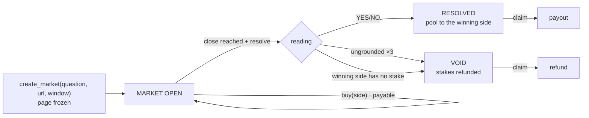

# Auspice

**A two-sided prediction market with no oracle.**

A market is a question and the page that will answer it. Two sides, YES and NO,
and one pool that grows as people back them. No bookmaker, no admin, no panel of
humans: when trading closes, anyone may ask the committee to read the page once,
and it has to copy the sentence that answers the question.

## Why it is a different contract

A betting market needs an oracle: some feed, some reporter, some signature that
tells the contract who won. Every one of those is a person with a key, and every
person with a key can be wrong, bribed or silent.

Auspice removes the oracle. The page is **frozen when the market opens**, the
committee reads it itself, and an answer without a quote taken from that page is
not an answer. Three properties follow:

- **Nobody can move the goalposts.** The question, the page and the criteria are
  immutable from the moment the first stake arrives. The creator cannot re-aim a
  market at a friendlier page, and neither can anyone else.
- **Odds are not declared, they are discovered.** The payout is parimutuel: the
  whole pool is split among the winning side in proportion to what each account
  staked. The contract never has to reason about a probability.
- **No money can get stuck.** A page that says nothing books an attempt and moves
  nothing; after three of those anyone may void the market, and each holder takes
  their own stake back by claiming it.

One account backs one side of a market, and may add to it, but never both. That
keeps `claim` a bounded, single-key operation: no loops over holders, no payout
that depends on how many people joined.

## Live on GenLayer Studio

`deployment.json` is the single source of truth for the deployed address: the
**Deploy Contract** workflow deploys the market once, writes the file, and
commits it back to `main`.

| | |
|---|---|
| **Contract** | [`0xce62214444a073A7B4C18563D7f3F20AdD815401`](https://explorer-studio.genlayer.com/address/0xce62214444a073A7B4C18563D7f3F20AdD815401) |
| **Network** | GenLayer Studio — chainId `61999` (`0xf22f`), test GEN only |
| **Evidence** | [Actions](https://github.com/weels007/genlayer-auspice/actions) — direct, Studio, money paths, every deployment |

The address is checked against this repository: `scripts/verify_deployment.py`
compares the recorded `revision` — the first twelve characters of the SHA-256 of
`contracts/Auspice.py`, written by the deploy script — with the checkout, and the
e2e workflow refuses to run when the two disagree.

## Lifecycle



## How a reading is produced

| Step | What happens |
|---|---|
| **Open** | A question (10–300 chars), an `https` page, optional criteria, and a close window (60 s … 30 d). All of it is frozen here. |
| **Trade** | Anyone backs YES or NO with at least `MIN_STAKE`, up to `MAX_POSITION` per account and `MAX_POOL` per market. One side per account. |
| **Read** | After the close, `resolve` renders the page as text inside a non-deterministic block, capped at `MAX_PAGE_CHARS`, and the model answers `YES`, `NO` or `SILENT` with a verbatim quote. |
| **Ground** | The quote must appear in the page after folding to letters and digits. A reading whose quote cannot be grounded is not a reading. |
| **Consensus** | Validators re-run the fetch and the prompt and must return the same `outcome`. Disagreement writes nothing. |
| **Pay** | The winning side divides the pool in proportion to its stakes; the last claimer takes whatever rounding is left, so the pool ends at exactly zero. |

### Error taxonomy

| Tag | Meaning | Consensus behaviour |
|---|---|---|
| `[EXPECTED]` | bad input, a closed market, a wrong side, a stake out of bounds | deterministic, must match |
| `[EXTERNAL]` | the page is empty | deterministic, recorded |
| `[TRANSIENT]` | network / 5xx, page unreachable | both transient means agreement, retry |
| `[LLM_ERROR]` | malformed answer, ungrounded quote | always disagrees → new leader |

## Money rules

The only value that enters is a stake, and the only places it can go are the
winning side and a refund.

- **`buy` never reverts once value is attached.** A refused buy — an unknown
  market, a closed market, a wrong side, a stake below the floor, a position or
  pool above its cap, a second side for the same account, a duplicate reference —
  becomes a **credit** owned by the sender, withdrawable with `withdraw_credit`.
- **The winning side takes the whole pool**, in proportion to its stakes. A
  losing position claims as well: it is paid nothing and its position is closed.
- **Rounding goes to the last winner.** The payout is `stake × pool ÷ winning
  pool`; whoever holds the remainder of the winning side receives the remainder of
  the pool, so no GEN is left behind.
- **A winning side with no backers is void, not a windfall.** If the page answers
  YES and nobody staked YES, there is no honest winner: every stake is refunded.
- **A market nobody could read is void.** Three undecided readings and anyone may
  void it; every stake returns to the account that bought it.
- **The ledger is updated first and the transfer last**, so a failed transfer rolls
  both back together.

Invariant: `total_in == total_out + locked_total`, credits included.

## Contract API

**Write**

| Method | Who | Purpose |
|---|---|---|
| `create_market(question, source_url, criteria, close_seconds, market_ref)` | anyone | open a market; freezes the question, the page and the close |
| `buy(market_id, side, buy_ref)` · payable | anyone | back YES or NO |
| `resolve(market_id)` | anyone, after the close | read the page once and settle the pool |
| `void_market(market_id)` | anyone, after three undecided readings | refund every holder |
| `claim(market_id)` | any holder | take the winnings, or the refund |
| `withdraw_credit()` | anyone with a credit | take back money from a refused buy |

**View**

| Method | Returns |
|---|---|
| `get_market(id)` · `get_markets()` · `get_market_ids()` | a market, all markets, the id list |
| `get_position(id, who)` · `get_payout_preview(id, who)` | one account's side and stake, and what `claim` would pay now |
| `get_credit(address)` | a refundable credit |
| `get_ledger()` · `get_balance()` | `total_in`, `total_out`, `locked_total`, real balance |
| `get_summary()` · `get_rules()` | counters, and the bounds the contract enforces |

## Security review

| Risk | How Auspice answers it |
|---|---|
| A movement of the goalposts | The question, page and criteria are written once by `create_market` and never edited. |
| An ungrounded citation paying somebody | A reading without a quote taken from the page becomes undecided, which moves nothing. |
| Stored text steering a later decision | The only consequential field is `outcome`, and it is the only field compared. Quote, reason and digest are descriptive. |
| The committee's answer contradicting the money | A winning side with no stake is void, so an answer nobody backed cannot confiscate the other side. |
| A market frozen by a silent page | Three readings, then anyone may void it; every stake stays claimable by its holder. |
| Any account moving somebody else's money | Payouts go only to the position's holder, and `withdraw_credit` is sender-scoped. |
| One account betting both ways | Refused and turned into a credit, so a position is always one side. |
| A pool that grows without bound | Per-position and per-market caps. |
| Rounding dust locked forever | The last claimer of the winning side receives the remainder, so the pool ends at zero. |
| SSRF through the source URL | `https` only, no IP literal, no single-label host, no metadata aliases, alphabetic TLD. |
| Replay minting a second market or a second buy | Caller-scoped references, recorded once. |
| Unbounded work | 500 markets, three readings per market, capped strings, O(1) summary, no loops over holders. |

Residual risks, stated plainly:

- **A page can change before the close.** It is read only after trading ends, so
  what the market resolves against is what the page says then, not what it said
  when the first stake arrived. The digest records exactly what was read.
- **A question can be ambiguous.** The criteria exist to pin the reading down; a
  vague question will sometimes come back SILENT rather than wrong, which is the
  contract refusing to guess.
- **Test GEN only.** There is no mainnet path, no audited token, and the caps are
  there to keep a demo bounded rather than to be economic parameters.

## Testing

| Suite | What it covers | Run |
|---|---|---|
| **Direct** | opening, every refusal, the two pools, the one-side rule, all three readings, the proportional payout, the dust rule, the void path and the ledger invariant | `pytest tests/direct -v` |
| **Studio** | the deployed market: a real market opened, two sides backed, a live reading after the close, the payout, and a second market filed against an ungroundable page that books three undecided readings, is voided by the other account, and refunds both stakes | `pytest tests/integration -v -s` |
| **End to end** | the paths that need no model: a stake below the floor, a wrong side, a duplicate reference, a second side for the same account, a position above its cap, a claim before settlement, a void before it is earned, and a stranger reaching for a credit | `pytest tests/e2e -v -s` |

Every assertion in the live suites is a delta, and every reference carries the
run's start time, so they can be re-run against the same market.

## Quick start

```bash
pip install -r requirements.txt

genvm-lint check contracts/Auspice.py   # forbidden imports, storage, nondet misuse
pytest tests/direct -v                  # the whole market, in memory, milliseconds
pytest tests/integration -v -s          # the deployed market, live
pytest tests/e2e -v -s                  # the deployed market's money paths

python scripts/deploy.py                # deploy once, record deployment.json
python scripts/verify_deployment.py     # the address on file is this source
```

The direct suite mocks the page and the model; both sides, all three readings, the
proportional payout and every refund are exercised in memory.

The live suites sign with throwaway Studio accounts that the repository keeps in
Actions secrets — one for each side of a market — so no key material is committed.

## Layout

```text
contracts/Auspice.py             the market
tests/direct/                    opening, trading, readings, views
tests/integration/               the deployed market, live
tests/e2e/                       the deployed market's money paths
testdata/ungroundable.txt        a page no quote can be grounded in
scripts/deploy.py                deploys once, records deployment.json
scripts/verify_deployment.py     the address on file is this contract
scripts/wallet.py                keystore from tests/ or a repository secret
deployment.json                  the deployed address (written by the workflow)
.github/workflows/               ci, integration, e2e, deploy-contract
```

## License

[MIT](LICENSE).
